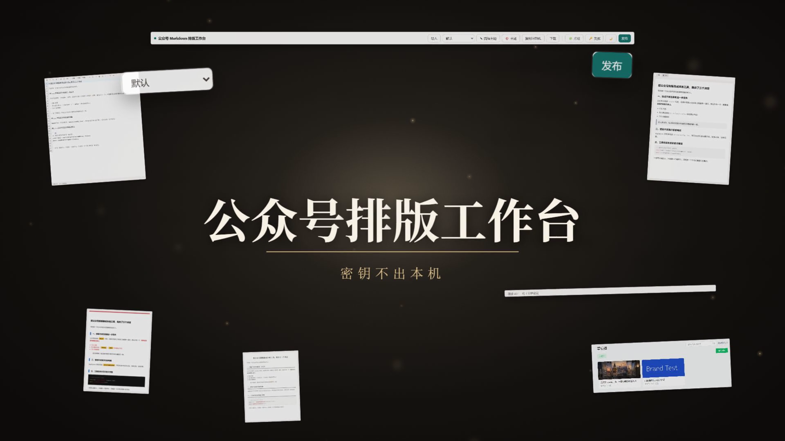
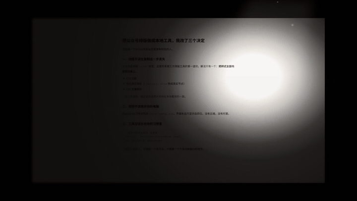

# wx-md-publisher · WeChat Markdown Publisher

A local-first Markdown → WeChat Official Account typesetting and publishing tool. Write Markdown on the left, preview the typeset article on the right, then copy it into the WeChat editor or publish straight to the drafts box. **All data stays on your machine** — no login, no cloud.

[中文 README](README.md)

[](docs/assets/demo.mp4)

> Click the cover for the 47-second product demo ([demo.mp4](docs/assets/demo.mp4))



## Why this tool

- **WYSIWYG paste**: copied content goes through a WeChat adaptation pipeline (CSS inlining + pseudo-element materialization + WeChat-specific fixes) — what you paste into the mp editor matches the preview **pixel for pixel**
- **22 themes**: full port of WeMD / doocs/md open-source themes + parametric custom themes, code syntax highlighting, GFM alerts
- **Zero setup**: Windows users download a portable bundle, unzip, double-click — **no Node.js installation required**
- **Secrets never leave your machine**: AppSecret is stored in a local file only; the UI never shows the full value

## Quick start

### Option 1: Portable bundle (recommended, no environment needed)

| Platform | Bundle | How to start |
|---|---|---|
| Windows | `wx-md-publisher-*-win-x64.zip` | Unzip, double-click **启动工作台.bat** |
| macOS (Apple Silicon) | `*-darwin-arm64.tar.gz` | Unzip, double-click **start.command** |
| Linux | `*-linux-x64.tar.gz` | Unzip, run `./start.sh` |

> No prebuilt bundle for Intel Macs (GitHub retired Intel macOS runners). Build one yourself with `node scripts/package.mjs darwin-x64` on any machine.

Download the bundle for your platform from [Releases](../../releases). The workbench opens in your browser automatically; close the console window to stop the server. The bundle **ships a Node.js runtime** — apart from a browser, there are no external dependencies.

> **Note**: extract to a writable location (Desktop, D:, …). Avoid `C:\Program Files` — saving credentials writes into the app folder.

> **macOS note**: if Gatekeeper blocks the first run, right-click `start.command` → "Open". Or run `xattr -dr com.apple.quarantine <extracted-dir>`.

### Option 2: From source (for developers)

Requires Node.js ≥ 18 (22 LTS recommended):

```bash
git clone <repo-url> && cd wx-md-publisher
npm install        # or: pnpm install --ignore-scripts
npm start          # builds on first run, then starts directly
```

Open http://localhost:3000 (auto-increments if the port is taken).

## Usage

### 1. Configure credentials (publishing only — copy-paste needs none)

1. Top bar → "🔑 凭据" → "新增账号": enter your official account **AppID** and **AppSecret**
2. Secrets are saved to `server/config.json` on this machine only; multiple accounts supported; the UI shows only the last 4 characters

> Find AppID / AppSecret at [mp.weixin.qq.com](https://mp.weixin.qq.com) → 设置与开发 → 基本配置 → 开发者密码.

### 2. Whitelist your IP (publishing only)

In the mp backend (基本配置 → IP 白名单), add your machine's public IP. Home broadband IPs change — after reconnecting, click "测试连接" in the Publish dialog: if it fails with the whitelist error, the dialog **shows your current public IP** with a one-click copy button.

### 3. Write & typeset

- Write Markdown on the left, live preview on the right; paste screenshots with **Ctrl+V**
- Switch between **22 themes** in the top bar; "🎨 主题" opens a thumbnail gallery; "✎ 编辑主题" fine-tunes spacing, colors and code style — save as your own theme
- Status bar shows word count and estimated reading time; 🌙 toggles dark writing mode

### 4. Export or publish

- **复制 HTML (Copy HTML)**: paste into the mp editor — styles match the preview
- **发布 (Publish)**: fill in title/author/digest + pick a cover → the draft appears in the mp backend drafts box; article images are auto-uploaded to WeChat's CDN

## FAQ

**Styles are lost after pasting into WeChat?**
Use the top-bar "复制 HTML" button (not selecting text in the preview). It inlines all styles into the HTML.

**Test connection fails with 40164?**
Your public IP is not whitelisted. The error box shows your current IP — copy it into the mp backend whitelist.

**Cover image error when publishing?**
WeChat enforces a size limit on cover material. Use a smaller JPG (< 1MB recommended).

**How do I back up my articles?**
Articles live in browser localStorage. Export content as `.md` files, or back up via browser DevTools → Application → Local Storage.

**"Directory not writable" when saving credentials?**
The app folder lacks write permission. Move it to a normal location (e.g. Desktop) and restart. The portable bundle cannot run from `C:\Program Files`.

## Environment variables

| Variable | Default | Description |
|---|---|---|
| `PORT` | `3000` | Server port (auto-increments when busy) |
| `WXMD_NO_OPEN` | — | Set to `1` to skip auto-opening the browser |
| `WXMD_CONFIG_PATH` | `server/config.json` | Path of the credentials file |

## Cross-platform support

| | Windows | macOS | Linux |
|---|---|---|---|
| Portable bundle | ✅ x64 | ✅ arm64 | ✅ x64 |
| From source | ✅ | ✅ | ✅ |
| CI tested | ✅ | ✅ | ✅ |

## Development

```bash
npm install                  # or: pnpm install --ignore-scripts
npm run build                # type check + build to public/
npm test                     # unit tests (vitest)
npm run smoke                # end-to-end server smoke tests (isolated port & config)
node scripts/build-themes.mjs   # regenerate theme CSS from themes-src/
node scripts/package.mjs win-x64  # build a portable bundle (defaults to current platform)
```

## Security design

- Binds `127.0.0.1` only; write endpoints validate Origin/Referer to block cross-site requests
- AppSecret stays on disk and APIs return masked values only; `server/config.json` is gitignored
- Markdown rendering blocks `javascript:` and other dangerous link protocols; highlighter output is fully escaped
- No telemetry, no cloud calls (except WeChat APIs and the public-IP lookup used for the whitelist hint)

## Acknowledgements

- [WeMD](https://github.com/tenngoxars/WeMD) (MIT) — source of 17 themes
- [doocs/md](https://github.com/doocs/md) (MIT) — source of 3 themes and the reference for the WeChat export pipeline
- [highlight.js](https://github.com/highlightjs/highlight.js) (BSD-3-Clause) — code syntax highlighting

## License

[MIT](LICENSE)
